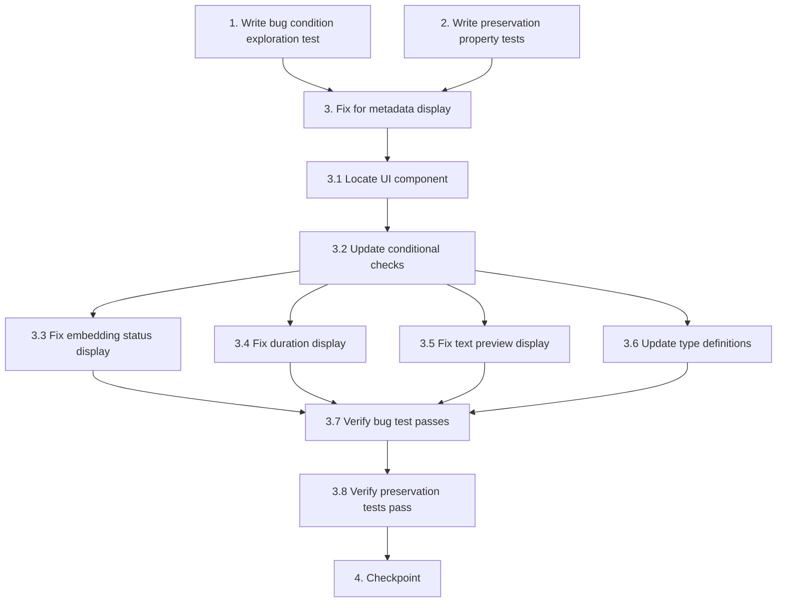

# Implementation Plan

## Overview

This task list implements the bugfix for indexing details metadata exposure. The bug occurs when the UI displays "Unavailable" fallback messages for metadata fields (embeddingStatus, indexingDurationMs, extractedTextPreview) even though these fields exist in the API response. The fix updates the UI component's conditional rendering logic to properly check for and display actual metadata values.

The implementation follows the exploratory bugfix workflow:
1. **Explore** - Write property-based test to confirm bug exists (test will fail on unfixed code)
2. **Preserve** - Write property-based tests to capture existing behavior to preserve
3. **Implement** - Fix the UI component's conditional logic and field name checks
4. **Validate** - Verify exploration test passes and preservation tests still pass

## Tasks

- [ ] 1. Write bug condition exploration test
  - **Property 1: Bug Condition** - Metadata Display Shows Unavailable When Data Exists
  - **CRITICAL**: This test MUST FAIL on unfixed code - failure confirms the bug exists
  - **DO NOT attempt to fix the test or the code when it fails**
  - **NOTE**: This test encodes the expected behavior - it will validate the fix when it passes after implementation
  - **GOAL**: Surface counterexamples that demonstrate the bug exists
  - **Scoped PBT Approach**: Test concrete failing cases - source with metadata fields populated but UI shows "Unavailable"
  - Test that when API returns source with embeddingStatus="COMPLETED", indexingDurationMs=1523, and extractedTextPreview="Sample text...", the UI displays these actual values instead of "Unavailable" fallback messages
  - Create test source with metadata fields populated
  - Verify API response includes all metadata fields (embeddingStatus, indexingDurationMs, extractedTextPreview, etc.)
  - Inspect UI rendering to check if "Unavailable" messages appear despite data being present
  - Run test on UNFIXED code
  - **EXPECTED OUTCOME**: Test FAILS (this is correct - it proves the bug exists)
  - Document counterexamples found: which fields show "Unavailable" when data exists, exact error messages displayed
  - Mark task complete when test is written, run, and failure is documented
  - _Requirements: 1.1, 1.2, 1.3, 1.4, 1.5, 1.6, 1.7, 1.8, 1.9, 1.10_

- [ ] 2. Write preservation property tests (BEFORE implementing fix)
  - **Property 2: Preservation** - Existing Source Functionality Unchanged
  - **IMPORTANT**: Follow observation-first methodology
  - Observe behavior on UNFIXED code for non-metadata-display operations
  - Observe: Source list displays name, status, chunkCount correctly
  - Observe: GET /sources/:id/chunks returns correct chunk data with pagination
  - Observe: Source CRUD operations (create, delete, reindex) work correctly
  - Observe: toJSON() transform converts _id to id in all responses
  - Write property-based tests capturing these observed behavior patterns from Preservation Requirements
  - Test source list rendering preserves basic fields display
  - Test chunk retrieval preserves correct data and pagination
  - Test source CRUD preserves correct database operations
  - Test API responses preserve _id to id transformation
  - Property-based testing generates many test cases for stronger guarantees
  - Run tests on UNFIXED code
  - **EXPECTED OUTCOME**: Tests PASS (this confirms baseline behavior to preserve)
  - Mark task complete when tests are written, run, and passing on unfixed code
  - _Requirements: 3.1, 3.2, 3.3, 3.4, 3.5, 3.6, 3.7, 3.8, 3.9, 3.10_

- [ ] 3. Fix for metadata display showing unavailable when data exists

  - [ ] 3.1 Locate and inspect the UI component responsible for displaying indexing details
    - Search for Svelte components containing "Unavailable", "Backend does not expose status", or "Timestamps not exposed" text
    - Identify the component file path (likely in apps/web/src/components/ or apps/web/src/routes/)
    - Read the component code to understand current conditional rendering logic
    - Verify which fields are being checked and how the fallback messages are triggered
    - _Bug_Condition: isBugCondition(sourceResponse) where sourceResponse has metadata but UI shows "Unavailable"_
    - _Expected_Behavior: UI displays actual metadata values when present in API response_
    - _Preservation: Source list, chunk retrieval, and CRUD operations remain unchanged_
    - _Requirements: 1.1, 1.2, 1.3, 1.4, 1.5, 1.6, 1.7, 1.8, 1.9, 1.10, 2.1, 2.2, 2.3, 2.4, 2.5, 2.6, 2.7, 2.8, 2.9, 2.10_

  - [ ] 3.2 Update conditional checks for metadata field presence
    - Replace incorrect conditional logic with proper null/undefined checks
    - Ensure field names match exactly what getSource() returns from the API client
    - Use proper null coalescing: `source.embeddingStatus !== null && source.embeddingStatus !== undefined`
    - Check for correct field names (e.g., extractedTextPreview not extractedText)
    - Add TypeScript type guards if applicable to prevent type errors
    - _Bug_Condition: isBugCondition(sourceResponse) from design_
    - _Expected_Behavior: expectedBehavior(result) - UI checks correct field names with proper null handling_
    - _Preservation: Preserve existing source display functionality_
    - _Requirements: 2.1, 2.2, 2.3, 2.4, 2.5, 2.6, 2.7_

  - [ ] 3.3 Fix embedding status display logic
    - Update conditional rendering for embedding status section
    - Check: `source.embeddingStatus !== null && source.embeddingStatus !== undefined`
    - Display actual status value with appropriate badge styling
    - Support status values: COMPLETED, PROCESSING, FAILED, PENDING
    - Show "Not Available" only when field is explicitly null or undefined
    - Remove hardcoded "Backend does not expose status" fallback
    - _Bug_Condition: isBugCondition(sourceResponse) where embeddingStatus exists but shows "Unavailable"_
    - _Expected_Behavior: Display actual embeddingStatus with status badge (2.8)_
    - _Preservation: Preserve existing status field display for source.status_
    - _Requirements: 1.1, 1.8, 2.1, 2.8_

  - [ ] 3.4 Fix indexing duration display logic
    - Update conditional rendering for indexing duration section
    - Check: `source.indexingDurationMs !== null && source.indexingDurationMs !== undefined`
    - Calculate human-readable duration from milliseconds (e.g., "1.5s", "342ms", "2.3s")
    - Alternative: Calculate from indexingStartedAt and indexingCompletedAt if indexingDurationMs unavailable
    - Show "Not Available" only when both indexingDurationMs is null/undefined AND timestamp calculation not possible
    - Remove hardcoded "Timestamps not exposed" fallback
    - _Bug_Condition: isBugCondition(sourceResponse) where indexingDurationMs exists but shows "Unavailable"_
    - _Expected_Behavior: Calculate and display actual duration in human-readable format (2.9)_
    - _Preservation: Preserve existing timestamp display for createdAt/updatedAt_
    - _Requirements: 1.2, 1.3, 1.4, 1.9, 2.2, 2.3, 2.4, 2.9_

  - [ ] 3.5 Fix extracted text preview display logic
    - Update conditional rendering for extracted text preview section
    - Check: `source.extractedTextPreview !== null && source.extractedTextPreview !== undefined && source.extractedTextPreview.length > 0`
    - Display preview text in formatted text area or pre-formatted block
    - Show character count from source.extractedCharCount if available
    - Show "No preview available" only when field is null, undefined, or empty string
    - Remove hardcoded "Extracted text preview is not exposed by the backend API" fallback
    - _Bug_Condition: isBugCondition(sourceResponse) where extractedTextPreview exists but shows "Unavailable"_
    - _Expected_Behavior: Display actual extracted text preview with character count (2.10)_
    - _Preservation: Preserve existing text display functionality_
    - _Requirements: 1.5, 1.6, 1.7, 1.10, 2.5, 2.6, 2.7, 2.10_

  - [ ] 3.6 Update TypeScript/JSDoc type definitions
    - Add or update Source interface to include metadata fields
    - Add fields: embeddingStatus, indexingDurationMs, indexingStartedAt, indexingCompletedAt, extractedTextPreview, extractedCharCount, embeddingsGenerated
    - Mark fields as optional (?:) to reflect they may be null for QUEUED sources
    - Add JSDoc comments documenting when each field is expected to be populated
    - Ensure type definitions match the actual API response structure from getSource()
    - _Bug_Condition: Type definitions may contribute to incorrect null checks_
    - _Expected_Behavior: Type definitions reflect actual API schema (2.11)_
    - _Preservation: Preserve existing type definitions for other source fields_
    - _Requirements: 2.1, 2.2, 2.3, 2.4, 2.5, 2.6, 2.7, 2.11_

  - [ ] 3.7 Verify bug condition exploration test now passes
    - **Property 1: Expected Behavior** - Metadata Display Shows Actual Values
    - **IMPORTANT**: Re-run the SAME test from task 1 - do NOT write a new test
    - The test from task 1 encodes the expected behavior
    - When this test passes, it confirms the expected behavior is satisfied
    - Run bug condition exploration test from step 1
    - Verify UI displays actual values for embeddingStatus, indexingDurationMs, and extractedTextPreview
    - Verify no "Unavailable" fallback messages appear when metadata exists
    - **EXPECTED OUTCOME**: Test PASSES (confirms bug is fixed)
    - Document that UI correctly displays all metadata fields
    - _Requirements: 2.1, 2.2, 2.3, 2.4, 2.5, 2.6, 2.7, 2.8, 2.9, 2.10_

  - [ ] 3.8 Verify preservation tests still pass
    - **Property 2: Preservation** - Existing Source Functionality Unchanged
    - **IMPORTANT**: Re-run the SAME tests from task 2 - do NOT write new tests
    - Run preservation property tests from step 2
    - Verify source list displays continue to show basic fields correctly
    - Verify chunk retrieval continues to work with correct data and pagination
    - Verify source CRUD operations continue to work correctly
    - Verify toJSON transform continues to convert _id to id
    - **EXPECTED OUTCOME**: Tests PASS (confirms no regressions)
    - Confirm all tests still pass after fix (no regressions in existing functionality)
    - _Requirements: 3.1, 3.2, 3.3, 3.4, 3.5, 3.6, 3.7, 3.8, 3.9, 3.10_

- [ ] 4. Checkpoint - Ensure all tests pass
  - Run all exploration and preservation tests
  - Verify bug condition test passes (metadata displays correctly)
  - Verify preservation tests pass (existing functionality unchanged)
  - Manually test the UI with sources in different states (QUEUED, PROCESSING, INDEXED, FAILED)
  - Verify edge cases: null metadata fields show "Not Available", populated fields show actual values
  - Ask the user if questions arise or additional validation is needed


## Task Dependency Graph



```json
{
  "waves": [
    {
      "name": "Wave 1: Exploration and Preservation Testing",
      "tasks": ["1", "2"],
      "description": "Write bug condition exploration test and preservation tests before implementing fix"
    },
    {
      "name": "Wave 2: Investigation",
      "tasks": ["3.1"],
      "description": "Locate and inspect the UI component responsible for indexing details display"
    },
    {
      "name": "Wave 3: Core Fix",
      "tasks": ["3.2"],
      "description": "Update conditional checks for metadata field presence"
    },
    {
      "name": "Wave 4: Field-Specific Fixes",
      "tasks": ["3.3", "3.4", "3.5", "3.6"],
      "description": "Fix individual field displays and update type definitions (can be parallelized)"
    },
    {
      "name": "Wave 5: Validation",
      "tasks": ["3.7", "3.8"],
      "description": "Verify bug condition test passes and preservation tests still pass"
    },
    {
      "name": "Wave 6: Final Checkpoint",
      "tasks": ["4"],
      "description": "Run all tests and perform manual validation"
    }
  ]
}
```

**Critical Path**: Tasks 1, 2, and 3 (including all sub-tasks) must be completed sequentially. Task 1 and Task 2 are independent and can be executed in parallel, but both must complete before starting Task 3.

**Parallel Opportunities**:
- Task 1 (bug condition test) and Task 2 (preservation tests) can be written in parallel
- Sub-tasks 3.3, 3.4, 3.5 can be implemented in parallel after 3.2 completes
- Sub-task 3.6 (type definitions) can be done in parallel with 3.3-3.5

## Notes

### Testing Strategy

- **Bug Condition Test (Task 1)**: This test MUST FAIL on unfixed code. The failure proves the bug exists and validates our root cause analysis. Do not attempt to fix the test when it fails - document the failure as evidence of the bug.

- **Preservation Tests (Task 2)**: These tests MUST PASS on unfixed code. They capture the baseline behavior that should remain unchanged after the fix. Use observation-first methodology: run the unfixed code, observe behavior, then write tests asserting that behavior.

- **Property-Based Testing**: Both exploration and preservation tests use property-based testing for stronger guarantees. This generates many test cases automatically and catches edge cases that manual tests might miss.

### Implementation Notes

- **Field Name Verification**: The most likely root cause is field name mismatch (e.g., UI checking for `extractedText` when API returns `extractedTextPreview`). Verify exact field names during task 3.1.

- **Null Handling**: Use proper null coalescing (`!== null && !== undefined`) instead of truthy checks to distinguish between legitimately null values and missing fields.

- **Type Definitions**: Update TypeScript interfaces or JSDoc to include metadata fields. This prevents type errors and improves IDE autocomplete.

- **Status Badge Styling**: When implementing embedding status display (task 3.3), reuse existing badge components if available for consistent UI styling.

- **Duration Formatting**: Consider creating a reusable utility function for formatting milliseconds to human-readable duration (e.g., `formatDuration(ms)`) that can be used elsewhere in the codebase.

### Verification Checklist

Before marking task 4 complete, verify:
- [ ] No "Unavailable" messages appear when metadata fields exist in API response
- [ ] "Not Available" or similar messages appear only when fields are legitimately null/undefined
- [ ] Source list view continues to work correctly (preservation)
- [ ] Chunk retrieval continues to work correctly (preservation)
- [ ] Source CRUD operations continue to work correctly (preservation)
- [ ] UI updates reactively when source transitions from PROCESSING to INDEXED
- [ ] Edge cases work: very long text previews, very large duration values, null status
